# 【超长文解析】动作游戏设计之难，究竟难在哪里？

> 来源：游资网 GameRes　作者：五十万　首发于奶牛关，GameRes 经作者授权转载
> 原帖：https://bbs.gameres.com/thread_828113_1_1.html

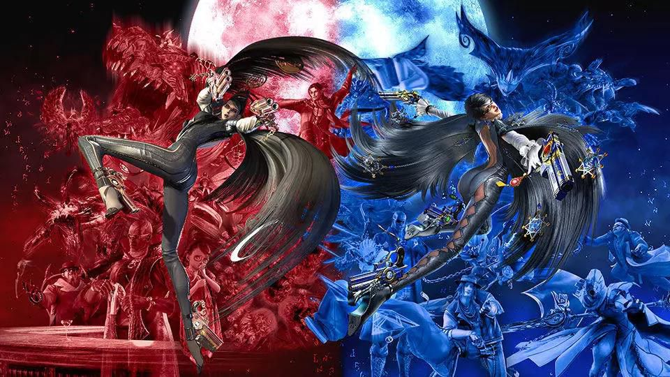

文/五十万

*本文首发于奶牛关，GameRes经作者授权转载发布。*
*如果你有更多关于动作游戏设计的想法，可以与作者交流，微信号frostfzy*

**1.前言**

因为一些不可抗力的原因，我参与开发的游戏再一次面临失败。

上一次失败大概是两年前，当时写了篇设计经验总结，如今看起来是有些弱智了。近一年半的工作都围绕动作游戏，便再写一篇动作游戏的，一是帮自己做一些整理，也是希望能给在寒冬中奋斗的小伙伴们一些帮助。

为了表意清晰，减少歧义，个人习惯是从概念梳理开始——或许写本文的主要目的就在于概念梳理。希望经过语汇的整理之后，能够提供一套相对扎实的基础，帮助建立设计与优化的路径。其实也就是把大家都知道的东西换一个方式再讲一遍而已。

大量干涩的铺陈导致本文并不适合通读，然而由于依赖一些概念演绎，本文隐约又在要求通读。所以我最后插了一些动图，移动端的话会比较费流量，另外动图受解码器影响帧率未必稳定准确，只能大致作为参考。所有动图截取均未获得授权，如果侵权请话知，抱歉。

**2. 动作游戏的设计难点**

身边的很多朋友在交流中常说，动作游戏不好做。为什么不好做？我仔细想了一想，总结出的设计难点有二。

**2.1. 先天的高度复合型决策设计**

在动作游戏中，最小操作/反馈单位都是一个高度集成的复合选项。每当玩家按下一个按键的时候，游戏机制反馈给玩家的都是打包好的一整套信息——最基础的包括攻击范围、攻击帧数、攻击力等，复杂的还会包括连段数、连技派生、打断效果、异常状态、浮空、免伤或霸体或无敌、破招或被破招、资源消耗与补充等等。一款以动作打击为主要玩法/卖点的游戏，需要能够提供足够丰富的内容，所以玩家与对手一起需要大量的这样复合决策设计的选项，才能够支持起一个复杂的系统。同时，通行的设计理论还要求这个这个系统呈现出一些特定的样貌，例如充分的均衡的博弈、丰富的可能空间、平滑的学习曲线等等，综合起来就形成了一个比较复杂的设计问题。

**2.2. 受到人的直观感觉的约束**

相比与其他的游戏品类，动作类游戏更加依赖表现支持，而动作表现与人的直观经验密不可分。人在某方面的直观经验越丰富，就越容易对该方面的失误敏感。在空间中运动的经验、使用四肢的经验，是人类拥有的最丰富的直观经验之一。所以，动作做得违背物理原理或者人体力学，是很容易被识别出来的事情。动画界有著名的12准则，是动画工作者用将近一个世纪的时间拆解出的人对于运动表现的直观而得到的规律，在这些规律之外，还要还涉及到演技的成分，例如游戏情绪、动作风格、角色性格等等要素，这些都约束着动作游戏的表现设计。

当然，在设计的难点之外，还存在大量的工程与执行上的问题，例如流程工序复杂，迭代周期长等等；还有市场导向的问题，动作游戏其实看起来爽但是其实并不怎么好卖，这都导致大家没有那么强的动力去解决这些问题。不过这些外部的问题就按下不表了，本文专门讨论的设计问题，所以仅根据上面整理的两大难点，分别梳理。

**3. 动作游戏与复合型决策**

首先需要承认的是，复合型决策并不是动作游戏独有的东西，别的游戏也处处都能找到（比如席德梅尔就很直白地说了）。大多数游戏的趣味也都同时在多个维度上衡量某一个或者一系列决策的利弊，这甚至发展成了一套完整的Game Theory，翻译过来叫做博弈论。

理解规则的最好方式在于观察他引发了怎样的行为，因此我们的分析可以从动作游戏的玩家的行为入手。这里，我只是根据个人的理解，引入一些概念，来对动作游戏中的复杂进行简单的拆解，其中第一个是深度。

**3.1. 深度**

**3.1.1. 深度与宽度**

深度是一个令人困扰人的词，因为总有一个充满迷惑性的词汇与他一起出现，即宽度。策划经常陷入争吵，我们新增的一个设计是把系统加深了还是加宽了？我为我的Metroidvania游戏添加一种新的钥匙和锁，或者当我给战斗添加一个暴击功能，这是内容的扩展还是机制的延伸？

为了回答这个问题，我们引入一个简单粗暴的公式：

**深度 = 宽度 / 反馈时间**

为帮助理解，简单举例。

一款TCG卡牌游戏，每当添加一类卡牌机制，都会影响到整体的构筑策略，因为规则的增加，加大了系统的整体复杂度，所以增加了宽度。由于这里反馈时间没有变化，所以深度也相应地增加了。游戏要求每当出现一种情况，玩家就按一个键，听起来是一个很简单的机制。然而这个简单的机制成就了大量的音乐类游戏，而没有人敢说音乐类游戏没有深度。音乐类游戏的深度源自对反馈时间的极度压缩。另外还有一些等价的概念可以引入。例如：可能空间Probability Space，指的是系统可以呈现出的全部情况的加总，在这个语境中，指的就是宽度；英文中还有一个常用的词语是Skill Ceiling，直译为技巧天花板，简单来说就是一个完全掌握游戏的玩家比一个完全不会玩这个游戏的玩家能够强多少，实际上也就等于我们说的深度。

动作游戏的宽度在所有的电子游戏类型中属于偏小的，这与前面提到的两个设计难点均有关系，高度集中的复合型设计使游戏空间更趋于离散而不是连续，直观经验对游戏的设计又有强力约束。由于宽度偏小，动作游戏往往采用压缩反应时间的方式，要求玩家尽可能及时、准确地做出回应，使得动作游戏常常比一些大宽度的游戏更具深度。

综上，宽度指的是游戏中可能情况的加总，而深度指游戏要求玩家处理复杂信息的速度。

**3.1.2. 动作游戏中的深度**

上面关于深度的说法是一个通用的说法，理论上对所有的游戏都适用，因为本文主要考察的是动作游戏，所以我们还是以动作游戏的视角拆解一下这个公式。

首先，民科地拆解一下人类处理游戏中的整体信息量的过程，大概分这么几步：

发生了什么？会怎么样？所以我该怎么办？

所以可以整理一下3.1.1.中的公式

**深度 = 发生的情况总量 × 蕴含的情况总量 × 对策总量 / 反馈时间**

**= (发生的情况总量 / 反馈时间) × 蕴含的情况总量 × 对策与执行总量**

此时我们可以把公式里的东西翻译成一些相对好理解的内容了，可以定义：

**反应频率 = 发生情况数量 / 允许的反馈时间**

外部规则空间 = 每一个发生的情况所能够造成的其他情况的总量

**操控精度 = 对策与执行的总量**

这样，我们大致掌握了一些基础概念，可以逐一深入分析了。

**3.2. 反应频率**

反应频率，即一定时间内玩家操作游戏的次数，等价于和RTS游戏中的APM。

反应频率这个概念，思路上延伸自稻叶敦志2016年的GDC演讲Action Without Borders，里面开门见山地提出动作游戏是一种基于反应的游戏。游戏不会呆呆地在那里等着你开始，而是自顾自地不断向你展现出种种的状态，并且提示你应该做一些什么来应对。所以这里借助操控频率指示的，是游戏呈现给玩家的玩点的密度，平均每隔多长时间，就出现一些需要玩家做出反应的事情。

当然，稻叶敦志一向是表演系动作游戏的坚定支持者，所以在游戏没有要求玩家做出更多回应时也会希望玩家拥有足够的自由，所以喜欢给角色花哨的技表，让玩家即便在面对很多同样的情况时，拥有较高的自由度去选择自己的行为。这些动作的设计主要针对的是玩家的攻击行为，所以我们称之为主动反应行为，用来区别于被动反应行为，即玩家以防御、躲避等形式响应游戏环境的行为。

（从动作游戏作为玩家对环境做出反应的游戏的意义上说，主动行为其实是玩家响应怪物的Opening的行为，也是被动地响应的。另外也有一些游戏会有Counter技，防御/无敌/霸体帧等等攻防一体的动作，不过这里不追求过于严格的定义，主要追求这样略带瑕疵的眼睛给了我们怎样的视野。）

这样我们可以区分玩家的主动行为与被动行为，于是有了下面的公式。

**反应频率 = 被动反应频率 + 主动反应频率**

下面简单整理一下与两种不同的反应模式相关的设计。

**3.2.1. 被动反应频率的控制**

以战斗为核心玩法的3D动作游戏中，被动反应频率主要由敌人的攻击频率决定。敌人的攻击频率由攻击动作、同屏敌人数量、出手机制等共同决定。这里探讨同屏敌人数量与出手机制。

非清版类动作游戏对敌人数量和出手机制的控制偏弱，因为玩家可以相对自由地选择战场，如果不小心陷入了1V多，一般问题不出在怪物出手不留情面，而在玩家引多了。然而，在战场严格受限的清版动作游戏中，对于怪物出手机制的控制就会相当严格。下面简要列举几种控制模式：

**a) 2 + 1 模式：《猎天使魔女》（以下简称贝姐）**

2+1模式指的是，同时只会有两个单位位于近战交战状态，可以发动近战攻击；同时只会有1个单位位于远程交战状态，可以发动远程/冲锋攻击；没有参战的怪物就在远处游荡或者示威。随着玩家的移动，参战的三只怪物可以自由地切换，但是从不会有两只怪物同时发起攻击。多数情况是，玩家盯着一只怪物打，同时留意身边另外两只怪物的行动。处于远程交战的怪物可能位于屏幕外，因此他发起攻击时会有明显的音效提示。贝姐的AI控制可以说是清版动作游戏的典范。

**b) 2 + ? 模式：《DMC: Devil May Cry》**

DMC与屏幕内同时出手的怪物有2只，因此略微允许不幸被怪物组合技连击的情况，他们对此的补偿是许多怪物有超长的攻击前摇。此外，DMC也同样坚持，玩家不应该受到来自屏幕外的伤害这样的原则，然而处理方式有一点简单粗暴，即不在玩家视野内的怪物不会发动攻击。所以当玩家遇到大量怪物的时候，避免危险的最好方式就是控制好视野，不看到其他怪物，打完再回头来（真·回过头来），有事会惊喜地发现怪物在绕公园。DMC也经常因为这种掩耳盗铃（居然还能成功）的模式被人调侃。

**c) 1 + 1 模式：《暗影魔多》**

贝姐的标准战斗不会超过1V6，而暗影魔多的战斗允许1V无限大，所以关于人群控制需要一些更加独特的技巧。其实就是大家围住主人公团团转但是每次只有一个人能出手，此外还有一个远距离交战的单位可以放冷箭，阵势很大但是并不刺激，更偏向表演。怪物们轮番上场每一次成功招架都伴随着一个温吞的摇镜宛若一个超低配版的松本宪生MAD。1+1与2+1的作用机理其实是一样的，只是魔多、蝙蝠侠类游戏在玩家的主动操作上太过死板，导致AI机制也一并遭人诟病。

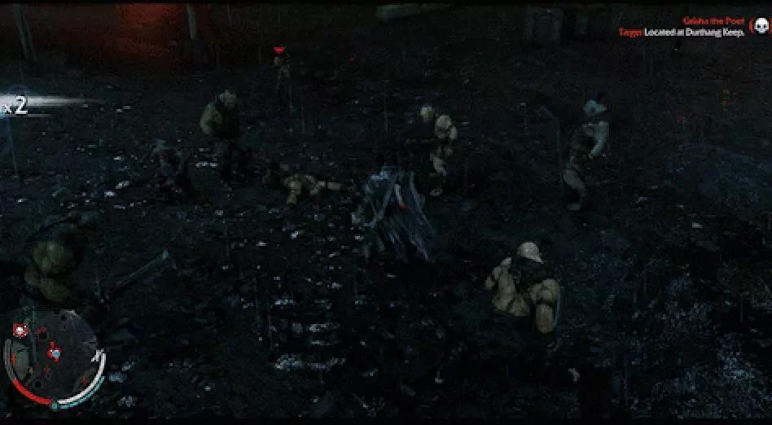

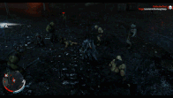

《中土：暗影魔多》中的怪物出手机制（和微妙的自动摇镜）

**3.2.2. 主动反应频率的控制**

主动反应频率由玩家的出手频率决定，主要受到动作时长与动作接续规则的影响。

动作时长即字面意思。本文中主要用帧数/帧率的方式来衡量动画的长度，帧数/帧率得到动作时长。动作我们留到后面关于反应时间与直观的部分再讨论。

动作接续规则即关于大家常说的后摇、取消等等机制的设计，以及衍生出的目押、序列技表等等玩法。

定性的描述是，动作接续规则越自由，主动反应频率越高，动作接续规则越死板，主动反应频率越低。具体的讨论见3.3.指令维度的部分。

**3.2.3.主被动反应频率的不同分布模式**

为了更好地理解，我们我们简单分析一下不同的反应频率组合的动作游戏，分别呈现出什么样的形态。

**a) 被动反应频率低，主动反应频率低：《怪物猎人》（以下称MH）**

夸张的帧数直接决定了MH不是一个高反应频率的游戏，如果30帧为标准帧率，MH多数武前摇帧数是30帧上下，再算上后摇，一个攻击动作需要花去1秒多的时间，在动作游戏中属于非常慢的。相应地，MH中怪物的行为也是比较慢的，一个大动作往往要数秒钟才能完成。

MH以慢制慢的战斗系统服务于用大型武器狩猎大型怪兽的核心概念。一击倒与起身保护也很好地平衡了玩家的压力。当然，慢并没有影响游戏的深度，这个到操作精度的部分我们聊。

其实MH在这里不是最佳的例子，还有一个更加双低的游戏叫《旺达与巨像》，不过战斗并不是《旺达》的核心玩法，所以略过不表。

**b) 被动反应频率高，主动反应频率高：《忍者龙剑传》（以下称忍龙）**

忍龙历作角色的攻击动作鲜有超过15/30帧（从动作开始到攻击生效），加上即时触发的斩杀，属于主动高频的典型。高被动反应频率体现在小怪利落的动作（也大多在15帧以内）、丰富的连段数、多样的进攻手段与凶悍的AI上。

双高的反应频率造成了忍龙紧张残酷的搏杀与命悬一线的感觉，可以说对忍龙在动作游戏界的地位做出了直接的贡献。

**c) 被动反应频率低，主动反应频率高：《胧村正》**

我们可以把这两个特点简单翻译一下。

主动反应频率高 - 玩家乱按一气也可以打得很爽打得有模有样被动反应频率低 - 我打别人一套，别人打我一下

这时就可以发现这其实是市面上绝大多数动作游戏设计的思路。而大家喜欢这样做也并不完全没有道理。被动反应频率低意味着游戏的动作难度不会很高，而主动反应频率高往往伴随着丰富的技表设计，正是大家都称赞的易上手难精通。

胧村正，还有同为香草社出品的奥丁领域，为了易上手做了一些更极端的事，把攻击和防御都放在了一个键上，鼓励玩家更加肆无忌惮地乱按一气。

**d) 被动反应频率高，主动反应频率低：《泰坦之魂》**

一般来说，低主动反应频率都不是动作游戏乐于看到的，因为这常常导致僵化的操作感。落入这一区间的游戏往往借助这种僵化感创造独特的战斗感觉。泰坦之魂就是这类，无论我打Boss还是Boss打我都是一击毙命，战斗的主要内容就是不断地闪躲腾挪以找到进攻的窗口。

**小结**

高主动反应频率是一般动作游戏的主流，给玩家在攻击手段上一定自由表达的空间，也能够体现出来游戏的流畅与爽快感。

低主动反应频率一般会更强调战斗的真实感，玩家对于每一次操作的期待更高，更容易带来成就感，同时也会带来一些相对异质的战斗体验。

低被动反应频率令游戏难度低，导致游戏相对愉快轻松；高被动反应频率令游戏难度高，导致紧张与压力。

**3.3. 操控精度**

操控精度指的是，常规的游戏环境对于玩家输入的准确度的要求。由于这里强调的是纯动作成分，所以如低HP与高时长带来的影响都不算在之列。

操控精度也是可以更加细致地分析的，我们先简单地抽象出三个维度，一个时间维度，一个空间维度，一个指令维度，然后又可以得到一个粗暴的公式。

**操控精度 = 操控时间精度 × 操控空间精度 × 指令维度**

**3.3.1. 时间精度**

指的是游戏对于玩家时机把握要求的精确程度。不过这里我们还是先澄清一下概念，这里指的时间精度专指，在一段连续时间中，针对分布在不同时刻的离散指令进行的设计。简单来说，不包括我要将摇杆推前多长时间，而仅包括我要在什么时候按一下特定的指令键。所以我们讨论的对象应该足够清楚，就是多数动作游戏中的类似精确闪避、精确格挡、盾反、招架这类的玩法。

在探讨时间精度设计之前，无可避免需要讨论一下标准反应时间。

**标准反应时间：黄金的0.3秒**

玩家做出反应是会消耗时间的，而人类的反应时间是有相对稳定的分布的，一般来说在0.1到0.5秒，0.3秒算是平均值。这个值非常关键，它将影响到动作与演出设计的方方面面。简单举例：

**a) 帧冻结时间**

很多游戏使用帧冻结来强调打击感，已经不是秘密。常见游戏的帧冻结时间在0.1 - 0.2秒，即3～5/30帧，我个人见过最长的帧冻结出现在MHX盾斧的光剑狩技，命中低肉质部位时最高达到 8/30 = 0.27秒的冻结时间，这也依赖极度夸张的动作与特效制造的预期。当冻结时间超过0.3秒的时候，帧冻结会成为特别引人注意的东西，令人分散注意力，打击感觉会渐渐从拳拳到肉的爽感变成奇怪的感觉。我曾偷偷地把自己的游戏帧冻结设置成1分钟，于是创造了一个令人百思不得解的Bug。

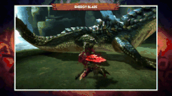

MHX盾斧光剑8/30的帧冻结，素材取自油管，Arekkz Gaming，Monster Hunter Generations Blade Tutorial

**b) 出手时间（动画长度）**

很多游戏强调快速流畅的动作，但是最快能有多快呢？《尼尔：自动人形》主武器小剑轻攻击前摇是10/60，完整动势在16~18/60帧结束，已经给人迅雷不及掩耳的感觉了。街霸5中多数角色站轻拳的帧数是4/60，算上完整的打击帧，总帧数可能在8-10/60不等了，但是街霸同样也有些补偿性的设计，即命中后凶猛的帧冻结（10~14/60）。这样玩家总还有0.2秒左右的时间来留意发生了什么。对尼尔这种全程自由取消无脑button smash的游戏，有没有这个时间都可以，而街霸这种需要玩家思考如何攻击的还需要搓招的游戏，这绝对是必要的时间。

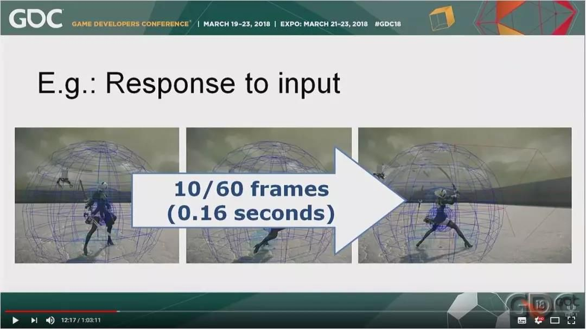

白金工作室田浦贵久揭秘尼尔的动作设计，素材取自油管，GDC，A Fun Time in Which Some No-Good Game Developers May or May Not Discuss How We Made NieR:Automata

**c) Staging**

动画十二准则之一，简单理解成舞台调度。主要说的是，画面中接连发生的事件时间上需要错开，否则就会制造一种应接不暇的感觉，观众也无法建立连续发生的事件的关联性。那么错开多久好呢？最少0.6秒，即人的标准反应时间的两倍。

**标准反应时间与时间精度控制**

当有了关于标准反馈时间的概念之后，再来看各种动作游戏的帧数设计，尤其是精确时间把控的玩法时，就大致有一些概念了。拿大家相对熟悉的《黑暗之魂3》（以下简称黑魂3）举例：

**时间精度的应用**

动作游戏是依赖精确操作的游戏，0.2秒到0.5秒的差别就是能反应过来和反应不过来的差别，所以我们依然可以有意义地区分不同游戏对于时间精度的要求。

《鬼泣4》尼禄在攻击动作中某个精确时间按下充能，可以获得3倍于非精确操作的充能效果，剑变成红色，素材来自油管，ChaserTech，DMC4 - Nero Advanced Combat Tutorial

**高时间精度**，0.2秒左右或以下的时间窗口，判定严格，门槛高，如鬼泣4尼禄的红剑充能

**中时间精度**，0.2-0.4秒左右的时间，绝大多数动作游戏关于精确玩法的窗口，如DMC的精确闪避等，MHX的武士道风格

**低时间精度**，0.4秒以上，一些对精确操作要求宽松的玩法，比如死亡细胞的盾反，暗影魔多的招架，仁王的残心判定等，或者一些没有精确操作玩法的游戏。

**3.3.2. 空间精度**

游戏要求玩家对于方位与距离把握的精确程度。这里可以清楚地看到多数的动作游戏对于操作精度理解的分野。这里依然还是划分出三挡精度的差别，由于2D空间环境与3D有巨大差别，只讨论3D游戏。

**低空间精度：《地狱之刃》**

因为地狱之刃的战斗非常平淡，所以拉出来讨论比较不容易引起争议。

先说玩家的主动行为，方向上强制锁定，距离上只有上步攻击与原地攻击两种，没有其他。玩家响应敌人的行动，与方位相关的，只有横攻击向后闪，纵攻击/冲锋攻击左右闪这样两种，AI也是清版游戏常用的2+1模式：2个距离最近的屏幕内的敌人 + 1个能够远距离甚至从屏幕外攻击的敌人。

可以说，地狱之刃的战斗几乎没有关于空间的设计。

**中空间精度：《猎天使魔女》**

长期以来，动作游戏都喜欢弱化关于方位的设计，使得辅助修正朝向与位移的功能成为标配。玩家只需要走到差不多的距离，摇杆推向差不多的方向，角色就会自动攻击到最近方位的目标；或者另外开放一个锁定相机，玩家的攻击就自动朝向锁定的目标。贝姐同时采用了两种。此外，还有多处在空间精度中让步的设计，如：

a) 自由的万向翻滚

b) 宽松的处决判定范围

c) 极尽人性化的冲拳、飞踢与浮空追击，无论目标位于地面还是空中，大多可以直接到位，造成伤害并且开始下一步的连击，方便得甚至让人怀疑浮空是否真的增加了游戏的空间维度。

d) 编织攻击可以自动出现在当前目标的位置，即便下踩和上钩拳也很容易击中远处的目标。

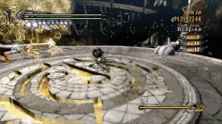

《猎天使魔女》中的编织攻击与冲刺攻击，很远都可以打中就很便利，素材取自油管，yoshesque，Bayonetta - Pure Platinum Explained

这种设计为玩家带来了极大便利，让他们把更大的精力放在自己攻防进退的节奏上，而不用再花额外的精力进行方位校准。

然而此外，贝姐还保留了一些考验空间精度的操作模式，例如猫模式的忽然加速、鸟模式的飞行、基于锁定目标方向的技表如↓↑B与↑↑B，还有在受击的瞬间摇杆推向伤害来源方向可以档掉攻击的圣物。怪物设计上，也有关于位于空中、地面、远处的不同打点的设计，也有考验跳跃能力的关卡。因此并不是说完全放弃了关于空间精度的设计。

以贝姐为标尺，我们大致可以找到其他经典游戏的位置：

旧作战神大概是最低的一级，不管怎么按都是两条链子舞得飞起DMC由于好歹保留了一些方向指令技表以及对不同武器的攻击范围的明确规划略胜一筹，强制锁定与傻瓜的式的拉取操作也让他属于相对宽松的一档血源凭借没有距离吸附以及PVP中的距离博弈胜贝姐一筹。忍龙凭借飞燕、落地吸魂等高端技巧再胜一筹。

**高空间精度：《怪物猎人》**

极少有游戏有MH一般细致的空间精度的设计。简要列举要点：

没有距离吸附，没有朝向吸附，因此控制打点成为一种特色的玩法。怪物拥有精细的肉质系统，全身不同位置受到伤害的比例不同，而怪物的体型非常大，不规则，运动轨迹复杂，因此有效的打点持续在空间中变动。攻击动作拥有形态各异的轨迹与判定空间，另外有浮动动作值系统，同一攻击动作中，挥击轨迹在不同位置击中造成不同伤害。远程武器拥有丰富的弹道行为，例如刚射/曲射、贯穿/扩散等。复杂的地形表面，各种高低差为打点控制增加了更多变数。

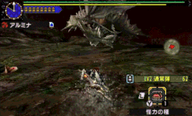

《怪外猎人X》中重弩锁头，要求极高的操作精度，素材来自B站，TGBUS电玩巴士，怪物猎人X重弩岚龙4分41演示视频

**小结**

对于空间精度的把握是最容易区分动作游戏操控精度的指标。

一般来说，为了避免给玩家太大的压力，高反应频率的游戏不会有太多关于高空间精度的设计，玩家游戏的过程中可以将精力更多地集中在技表与变招上。

低反应频率的游戏可以通过提高对于空间精度的要求来增加一些深度，我们可以看到MH和魂系列都有相应的设计倾向。另外PVP玩法也能放大人类对于空间精度的不同把握能力，细致的空间精度规划能够带来一些好处。

然而，关于时间精度的设计可以围绕标准反应时间展开，关于空间精度的设计便缺乏比较扎实的依据，所以做的好非常难。目前看到的优秀设计大多来自长时间的迭代，需要玩家群体与开发者的共同努力。

**3.3.3. 指令维度**

指令维度实际上包含了决策与执行两方面的内容。

决策是指，当一个需要玩家做出反应的时间发生时，玩家可以做出的反应。做出相应的决策是需要规则支持的，只是目前我们还没有讨论到规则，所以只是讨论可能的操作种类，包括指令技表、序列技表、组合键等。

执行指的是将具体的指令执行出来，与前面说的时间精度有微小的重叠。

先放一些简单定性的结论。

决策越丰富，深度越大。

执行难度越高，深度越大。难度和深度是相似的概念，具体会在后面介绍难度的部分展开。

这部分是本文最后开始写的部分，因为精力有限暂时先坑了，以后会努力补上（我肯定要找机会吹一波Dodge Offest的）>_<

**3.3.4. 其他类型游戏中的操控精度与深度**

精确操作并不是动作游戏所特有的东西，有很多游戏都会还可以延伸到其他的游戏类型中去，这里粗略举几个大类说明一下。

a) 有很多单纯靠控制时空精度就创造出自足玩法的游戏，例如平台跳跃类与赛车类，不过一般这类游戏的操作都是关于连续时间的连续指令的。

b) 音乐类游戏，如OsuMania，时间精度极高，并且与空间精度是同一个变量，深度主要来自极高的反应频率；点击类的Osu!相比于OsuMania，减少了一部分指令维度，而创造出来一部分空间精度，总体变化不大，还是主要依赖反应频率。

c) STG游戏一般没有专门的关于时间精度的玩法（决死Bomb除外？），而且指令维度相对单调，游戏的的主要深度来自极高的被动反应频率与极高的空间精度要求。

d) Moba类游戏也有非常高的深度，不过可以发现其中的一大部分来自于外部规则空间，这一点我们马上要讲。

**3.4. 外部规则空间**

前面提到，外部规则空间控制的是对游戏中发生的事情造成的影响。就好比我这下打下去，你可能会死。与外部规则相关的主要设计来自数值计算与胜负条件判定，多数与动作本身无关，但是这些规则依然会影响玩家的目标与决策。

动作游戏为了强调关于反应的动作玩法，往往不会设计太丰富的外部规则，也是前面我们说动作游戏宽度一般不高的原因。不过动作游戏的外部规则空间依然是需要设计的东西，而且值得探究的内容也不少。这里我不打算具体地整理我玩过的动作游戏中的每一个系统，只是简单地说一些外部空间的设计角度，并且简单列举一些相应的规则设计。

**3.4.1. 关于难度**

难度与深度描述的是相似的事情，只是从不同的侧面来说的。深度表示这个游戏系统理论上能够有效地区别出的最高的信息处理速度，而难度是达成游戏中的某个目标所要求的信息处理速度。

如果给定一个游戏目标，我们可以用某个特定水平的玩家的达成率来描述难度。达成的玩家越多，则难度越低，达成的玩家越少，则难度越高。如果要求达成的特定目标不变，提升反应频率或操控精度都会影响游戏的难度。不过我们这里探讨的是外部规则设计，所以先整理一下已知信息：

基于前面的讨论我们有：

我们分割游戏的最小单位是一次反应；一段游戏是一个综合目标，其中包含多次反应；反应频率和操控精度不属于外部规则；难度是以玩家的达成率来衡量的。

由此可以得到，想要仅仅通过外部规则提升难度（降低玩家的达成率），能做的只有增加反应的次数，在同等的反应频率下，就是延长游戏的时间。并没有哪个单一反应的难度提升了，而是达成一个由更多次反应汇集起来的综合目标的机会减少了。

简单举例，设计这样一个打Boss的游戏，玩家击中Boss20次则胜利，被Boss击中5次则失败。保持其他条件不变，单纯将Boss的血量提升至2倍，游戏的难度会提升，因为目标转变为在被Boss击中不超过5次的情况下击中Boss40次；保持其他条件不变，将Boss的伤害提升2倍，游戏的难度也会提升，因为目标转变为，在被Boss击中不超过3次的情况下击中Boss20次。

我们也可以基于这个思路来考察一些其他的常用概念。

**容错性**：一个系统，如果要达成一个特定的综合性目标，能够允许多少子目标不被达成。

**惩罚性**：对于某个特定的子目标，当其未能达成时，会在多大程度上使得主目标也无法达成。惩罚的反面是奖励，当奖惩机制依然有效的时候，一般意味着游戏还没有结束。

容错性描述的是拥有综合性目标的系统的特性，而惩罚描述的是一个特定失败对于系统的影响。依然拿黑魂举例，如果提升Boss特定攻击的伤害，那么提升了该次攻击造成的惩罚，略微降低了整体容错；如果强化一次元素瓶，并没有显著降低Boss的惩罚，但是提升了容错；如果提升角色的血量，从被Boss连续击中2下就死变成被Boss连续击中3下才死，降低了惩罚也提升了容错。

当以击败某个Boss为目标时，黑魂的惩罚性是较高的，因为玩家两三下就会被Boss打死；对于一个大目标而言，例如完成游戏，每一个小目标失败的惩罚性便不那么高，毕竟还有篝火和捷径。 总的来说，黑魂的难度主要来源于用低容错/高惩罚要求玩家重试。

**难度曲线：随游戏进展，游戏难度的变化轨迹**

依然拿黑魂举例，随着游戏进展，黑魂的游戏难度提升大多来自于外部设计，而动作相关的深度在一开始就已经完全地暴露给玩家了。而黑魂在动作设计上，反应频率偏低，指令维度低，时间精度与空间精度中规中矩，导致黑魂的绝对深度并不高，随着玩家一边玩水平一边在提升，多数玩家都会觉得黑魂玩到越后面越简单，当然这种成就感也正是黑魂想要赋予玩家的。

**小结**

从这里可以看出，玩家们一般都不太喜欢通过外部规则来提升难度的设计，游戏往往也不会因为更难而更有趣。针对动作游戏，如果一定要提升难度，最好还是从反应频率和操控精度上入手，这样在玩家失败时，更容易归因于自己，进入失败 -> 学习 -> 掌握 -> 成功的结构中。不过不同的玩家对于操控精度的耐受度不一样，怎么让玩家失败在一个Sweet Spot将会是一个复杂的问题。

此外，难度也绝非引导玩家探索游戏深度的好入口。多数动作游戏都喜欢采用低被动高主动的反应频率分布，正是为了降低硬性的难度，而把深度放在那里让玩家自主探索，即所谓的易上手难精通。很多备受吹捧的动作游戏使用外部设计来驱动玩家探索游戏的深度，最常用的是分数与评价，如鬼泣的SSS，贝姐的白金奖章，忍龙的Karma。还有一些则是纯粹由玩家探索个人能力与系统边界的意志驱动的目标，如MH的速杀，黑魂的无伤通关等。

**3.4.2. 关于反馈循环**

反馈循环的概念大家应该不陌生，这里还是容我废话两句。

反馈循环分正负两种：正反馈循环指的是系统呈现出某种状态后接下来会更容易出现同样的状态；负反馈循环指的是系统呈现出某种状态后变得更不容易出现同样的状态。简言之，正反馈会导致系统定向地偏离初始状态，放大系统的不平衡；负反馈会导致系统稳定在初始状态，减少系统的不平衡。

**3.4.2.1. 动作游戏中的正反馈设计**

**a) 受击硬直**

动作游戏中有一些天然地符合正反馈的设计，挨打的一方因为要做受击动作，所以就更容易继续挨打，便衍生出了Combo与控制链的玩法。由于这种打一拳抖一下的规则过于简单粗暴，许多游戏引入了一些外部规则，来限制这种正反馈的效率，然而并未从根本上打破正反馈。例如：

崩坏3的怪物护甲猎天使魔女的击晕黑魂由韧性系统判定的受击动作，伤害积累引发的大受击动作（可处决）忍龙的断肢处决也属于一种特殊形式

**b) 资源管理：积累与爆发**

正反馈的资源管理系统常常会采用积累 -> 爆发的模式，每当玩家命中/造成伤害，都可以积累资源，达到一定程度后为自己创造更大的优势。例如：

但丁的Devil Trigger贝姐的魔晶球奎爷的斯巴达之怒格斗游戏中的Power，可以用来Counter掉对方的攻击或者放必杀

**3.4.2.2. 动作游戏中的负反馈设计**

**a) 受击保护**

指的是，一旦遭受攻击/伤害，就变得不容易再次遭受攻击/伤害的系统。例如：

DNF的浮空保护，玩家浮空受到的伤害越高落地速度就越快，越不容易被追加伤害街霸的连段伤害保护，玩家受到一次性连段伤害越高，追加动作的伤害效率就越低击倒/起身保护，见于大多数游戏，玩家/怪物被击倒之后会无敌

**b) 消耗->恢复式资源管理**

指的是游戏扩大优势必须消耗某种资源，资源以有限的速率供应，因此资源限制导致不能无限制地扩大优势，在动作游戏中最常见的表现是体力系统。

MH、黑魂的体力系统技能冷却机制胧村正的武器耐久

**3.4.2.3. 正负反馈循环的结合，以MH为例**

拿MH说，也是因为MH的外部设计比其他动作游戏丰富太多。

关于玩家资源，MH整体偏向是消耗->恢复的负反馈模式，因为耐力有限，道具、弹药数量有限，玩家的行动不会有太大的偏差。然而，明显可以感觉到，MH在不断向游戏中引入更多的正反馈。

首先是，为大量武器加入了一些轻量的资源管理玩法，其中典型属于正反馈的有太刀、双剑和斩斧，X还引入了饱受争议的狩技来放大正反馈的循环。关于硬直处理，MH有基于部位伤害积累与破坏触发的硬直、异常状态积累触发的硬直、3代加入的疲劳系统、4代加入的骑乘系统、MHW大幅度丰富的环境交互，都在试图创造更加丰富的战斗动态，避免长达15-30分钟的单人狩猎陷入过于死板的模式。

然而在这基础上又会引入进一步的负反馈系统来减少过大的偏差，例如对怪物的异常状态、疲劳、骑乘的保护机制，避免负面状态的无限连。此外，负反馈还包括对玩家的保护机制，几乎所有攻击都是受保护的击飞和击倒，避免已经受击的玩家再受到追加的伤害。官方会表示会针对性地调整AI，避免玩家无解直接被连死的情况出现（只是可能没有完全杜绝，被白电龙甩尾接雷球扫地打出麻痹再大跳骑脸一波带走什么的感觉还是伤害我很深）。

**小结**

丰富的反馈循环可以极大地丰富游戏的动态。

对于动作设计上的反馈循环，一般来说，PVE游戏可以较为放心地使用正反馈，为玩家带来优势持续积累的爽快体验；PVP游戏就需要克制一些，引入一些负反馈，避免全面造成一边倒的局面，令失败方丧失参与感。

对于资源管理的模式，高反应频率的游戏倾向使用积累->爆发式的正反馈循环，强化爽快的感觉；而低反应频率的游戏更倾向于使用消耗->积累式的负反馈循环，更加注重策略性与节奏的平衡。

**3.4.3. 关于清版**

早期的动作游戏都属于清版游戏，要把刷出来的怪都打死才能前进，其中包括包括大家熟知的《三国战纪》、《双截龙》等。在动作游戏最为辉煌的时代，盛行的游戏也都是清版动作游戏，所以关于清版和不清版的设计分野总共是绕不过去，简单说两句，这里还是主要讨论3D游戏。

**3.4.3.1. 清版设计 - 代表：《鬼泣》、《猎天使魔女》、《战神》**

可以说，清版动作游戏的全部玩法就是动作，所以战斗都会发生在一个相对封闭的环境中，允许玩家心无旁骛地对抗敌人，一旦开战至死方休。为了强调纯粹的动作玩法，游戏会努力剔除其他元素的干扰，因此一般不会有复杂地形，也会尽量避免让玩家受到来自屏幕外的伤害，这些在前面反应频率的部分已经讲过。

**3.4.3.2. 非清版设计 - 代表：《黑暗之魂》、《怪物猎人》**

非清版设计更强调探索与氛围沉浸感，也更加鼓励玩家利用动作机制之外的手段来游玩，因此游戏的内容会发生一些变化。下面列举一些关于非清版游戏的设计空间。

备战。非清版类游戏往往有大量收集要素来鼓励玩家探索，因此MetaGame的成分明显会更丰富，因此往往包含丰富的装备与道具的选择，比如无双的角色养成，MH与魂的装备与道具管理遭遇。战斗可以不是正面的公平对决，玩家有更大的空间自主选择有利的战场，与开战模式——当然怪物也可以这样做。典型例子如魂系列，视公平对决为无物，处处都是埋伏，当然玩家也毫不介意报之以恶意——背刺、引怪、地形杀等，成为许多玩家被教育出来玩法。脱离。非清版游戏都会有战斗脱离的手段，如MH打不过可以换区，不过你会逃怪物也会逃。

整理之后可以明显发现，非清版游戏拓展出来设计空间跟动作玩法关系不大。另外，一些在清版设计中需要交严格遵守的设计准则在非清版游戏中也大多被抛弃了，例如平整规则的战场，有所保留的怪物攻击模式等。不过非清版游戏也需要实现非玩家单位的穿越复杂地形的能力，以及不同战斗状态的不同行为，如巡逻、搜索、战斗、脱战返回等，造成一定的工作量。

这里比较迷的是《真三国无双》，原则上算非清版游戏，然而他的大量设计都是依照清版游戏的规则做的。

**3.4.3.3. 混合型设计 - 代表：《刺客信条》、《暗影魔多》、《龙之信条》**

混合型的游戏多数是这种大而全的大世界游戏，有庞大的探索内容与丰富的地形穿越手段，潜行与动作玩法兼顾的品类。说实话我比较少玩这类游戏，感觉两边的坑都要踩，而且经常两边都不讨好，很辛苦。

**3.4.4. 外部规则与动作的互通**

由于前面讨论难度时已经讨论过纯粹的外部设计，这里就再聊一些与外部设计与动作玩法能够互通的部分。

**外部设计补偿动作玩法：《黑暗之魂》**

专门指一些资源积累与分配的策略能够影响到动作玩法的设计，在ARPG中非常常见。

黑魂3中的韧性系统。围绕韧性展开的设计包括：武器的削韧，动作的强韧、负重与护甲提供的韧性，冻伤Debuff影响的韧性等。在交战中，多项数值综合运算，判定受击方是否强制被打出受击动作，这直接影响了攻击方是否可以借机扩大优势，从而直接影响到动作与反应的节奏。

此外还有一些其他的游戏，简要列举：

MH中的配装与技能效果。配装是关于素材收集与资源分配的外部设计，然而其中大多数可以对动作效能造成影响，从而影响反应频率与操控精度。

集中 / 纳刀 / 反动 / 装填速度，分别缩短了蓄力时间 / 收刀时间 / 射击后坐力 / 装弹时间，提升了游戏的操控性能，即主动反应频率耳栓 / 耐震 / 风压 / 气绝 / 雪泥无效 / 细菌学 / 狂击耐性 / 英雄之盾，让玩家可以忽略特定的需要用操作应对的游戏内容，降低了被动反应频率回避性能 / 防御性能 / 心眼，提升动作性能，放宽时间与操控维度的要求，降低了操控精度。

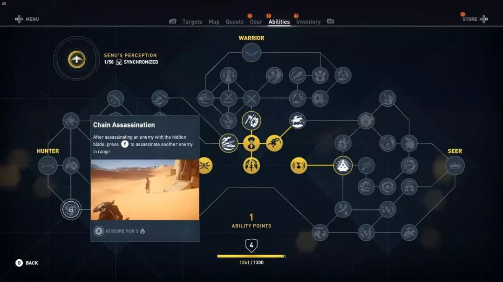

《刺客信条：起源》中的技能树设计，多数是在让玩家已经能够做到的事情变得更加容易做到。DNF中的攻击速度、硬直、浮空力等数值，不详细展开。

**动作玩法补偿外部设计：《仁王》**

当玩家完成精确操作时，游戏会赋予玩家一些外部的奖励，这里的最佳案例是仁王的残心玩法。讨论残心之前，我们先看一下动作游戏中关于风险与收益的常见设计：

等待技表，即序列技表中XX·X的派生动作。XXX只要无脑连打就可以，而XX·X需要在输入两次X之后等待一段时间，再追加其中·代表玩家支付的额外时间，会令玩家面临受击的风险，然而如果能够执行，一般XX·X会比XXX造成更高的伤害。精确反应。指的是前面说过的类似盾反和精确闪避之类的玩法，玩家需要在即将受击的时间执行动作，因此会面临更高的受击风险，然而一旦执行，都会有额外的数值、进攻机会奖励。

残心玩法同样延续了这一思路，并且用更线性、便于量化的方式体现出风险与收益的关系。当玩家在消耗了一定的体力之后，可以通过原地等待一定时间后，执行特定操作，立即回复已经损失的体力。等待时间是玩家支付的风险成本，耐力是收益，也是驱动玩家进一步造成伤害的资源。残心系统在原本的消耗->恢复机制中引入了加速恢复的动作玩法，由动作来到动作去的正反馈，是相当漂亮的设计。

此外还可以一提的有：

Furi中，成功防反近战攻击可以小幅回复血量贝姐中触发魔女时间可以回一个魔晶球并获得魔女时间DNF中手搓技能的冷却时间少于快捷施放

**小结**

对于依赖动作玩法又注重养成的游戏，打通外部规则与动作玩法是非常必要的设计。

简单的做法，可以通过一些收集与养成玩法渐进性地开放游戏的深度，例如各种经典的清版动作游戏，随着游戏进行获得更加丰富的技表，遭遇更加强大的敌人。

进一步的做法，可以依据符合风险与收益对等的原则，兼顾以下两者：技巧稍差的玩家自忖面对挑战会有困难，因此可以借助外部资源使得挑战更为宽松；技巧过硬的玩家则不必如此，可以将节省的资源投入到其他的地方。

原则上，这种思路是会衍生出氪金玩法的，所以重氪金的动作游戏也往往有非常丰富的动作玩法与外部规则的转化途径，如DNF、洛奇英雄传等。

**4. 动作游戏与直观经验**

首先解释一下直观经验。

这里的直观经验，就字面上的解释，说的是凭感觉就能产生的认识。说得具体一点，人经过长期的思考所形成的认识，内化在人的心中，当人下一次面对的时候不需要思考就能够得到答案。它还可以和大家熟悉的很多词汇意思相近，例如思维范式，肌肉记忆等。

有许多直观经验是受生理结构支持，在无意之间积累的起来的。比如，人类在生理上拥有强大的识别人类五官的能力，因为人类有一些天然的社会需要，需要分清谁是谁，需要认清谁处于什么情绪中，然而多数人并没有知性地描述其他人五官特征的词汇，这是人自我发展成型的直观经验。顺带一提，为什么明星、长相、演技总是电影里最具话题性的元素？因为不是所有人都懂镜头摄影灯光调色，但是通过观察别人的脸做出相应的悲喜、美丑、好恶等价值判断，是全人类共有的经验，话题自然也就多一些。

物理经验同样是一个基于长期的实践形成的直观认识，比如人回忆自己的成长经历，无法回忆起自己意识到世界上的所有东西都会向下落这样的瞬间。所有人都如此自然地生活在重力的世界里，甚至在牛顿之前，鲜有人把物体会下落当作一个需要研究的问题。所以当力的感觉错了的时候，人是很容易注意到不自然的。而对于这种不自然，人往往没有合适的语言与描述，就好比你去街边找一个平庸的画手为你画了一副素描，你看着只能说出不像不好看，但是说不出哪里不像不好看。而动作游戏生来就要接受这种直观经验的检验，并且对抗这种言语难以表达的不适感。

语言是塑造思维的工具，如果想要讨论直观，那么最好还是发明一套能够描述直观的语言。下面我会从观赏性和可读性两个方面来简要分析，试着提供一些分析的角度。

**4.1. 可读性**

可读性指的是，动作，包括综合的表现设计，能够多准确地传达动作所指示的游戏功能。如果观赏性主要是动画师专攻的领域，那么动画可读性至少是策划可以触及的领域了。

粗略来说，动作设计越不明显、越不符合物理直观，可读性越低。更细致的话，也从相机、动画设计与辅助设计三个方面来谈。

**4.1.1. 相机**

相机/视野设计的功能性其实是游戏设计重要的一环，只是市面上的成熟品类都有成熟的相机方案，大家都不太愿意再花时间来细致探究了。如果要详细说有很多门道，就不展开了，我这里简要提及一下视野设计与可读性的关系，以及相应的相机设计的简要注意事项。

越大的东西越可读越靠近注意力集中点的东西越可读画面越简单、干扰越少越可读越清晰的越可读

**Field of View（以下称FOV）**

基于上述的原则，我们可以简单谈及一下FOV。影视摄影中使用镜头焦距来控制广角，而游戏中的虚拟相机直接使用广角控制广角，这个角度即FOV。

FOV越大，视野就越大，方便玩家看到更多的周遭环境，相应地每样东西就更小。一般来说适用于1V多玩法，尤其是对于空间中运动丰富的游戏，视野大可以给玩家留出更多的时间以应对忽然闯入视野的物体，因此也常常用于强调速度感，例如各种赛车游戏的液氮模式。

FOV越小，视野就越小，玩家的视野会更加集中，看到的每一件东西就越大，一般来说，低FOV适合1V1玩法，强调读招与拆招的游戏。

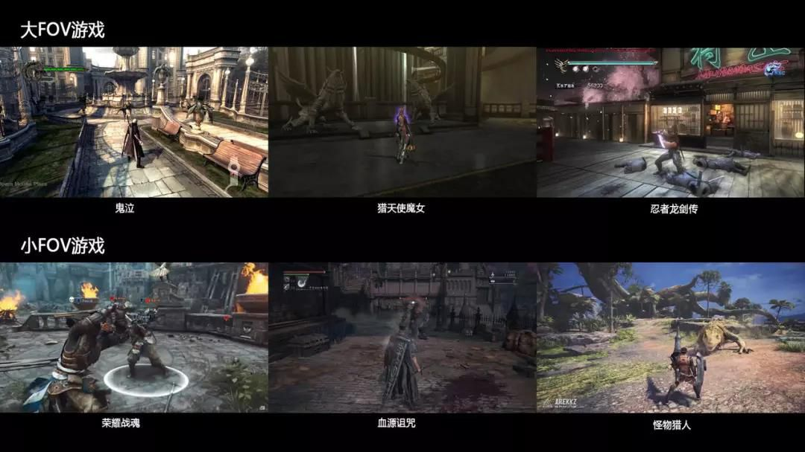

**相机运动模式**

一些大世界游戏因为玩法丰富，会针对不同的玩法设计不同的相机模式，实际游戏中的相机会不停变化。一部是为了配合演出，例如震屏与特写动作；另一部分也是服务于游戏玩法，让玩家更清楚地认识空间关系，方便做出正确的反应。由于本节主要讨论动作可读性，这里简要列举一些功能性的相机模式：

自由相机：第三人称跟随相机模式，会根据游戏的具体需要做一些FOV或者构图设计，在看环境与看角色之间平衡。
战斗相机：一些游戏会强调战斗与非战斗体验的区别，因此会专门设计不同的相机模式，在进入战斗之后，一般会增大FOV，帮助玩家掌握战斗环境。
锁定相机：倾向于让目标尽可能地出现在视野中特定位置的相机模式，对于频繁地高速运动的游戏，或者强调1V1的游戏有良好的效果。
演出相机：服务于一些表演性的丰富的动作，或者相机本身也成为表演的一部分，我们在后面关于观赏性的部分也会提到。

**后处理**

后处理的多数技巧都用来呈现特定的艺术效果，主要用于提升观赏性。当然，对于过快的动作，合理的后处理也可以辅助来增加动作的可读性，如动态模糊。

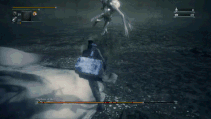

1/4速度下的《血源诅咒》，动态模糊帮助玩家视觉上捕捉到Boss速度最快的那一处动作。另外本图也很好地说明，锁定相机模式对于1V1体验的辅助与强化。素材来自油管，Kamies，Bloodborne - Orphan of Kos - Backstab and Parry Guide

**4.1.2. 动画设计**

动画设计的原则也很简单，剪影越清晰越可读，运动越符合直觉越可读。关于针对动作游戏的动画设计，最佳材料还是Mariel Cartwright小姐姐的GDC讲座，附B站链接。

**a) 剪影**

剪影是动作的外轮廓，优秀的剪影能够有效地帮助人识别动作。

剪影可以很好地修补前面关于越大越可读的原则的纰漏。大家觉得在玩MH在怪物肚子下修脚时，怪物确实占据很大画面，但是依然难读，主要问题就在，不能完整地显示怪物，以至于剪影被破坏了。基于剪影，可以进一步地引入一个特征帧的概念，指的是动作中最能够辅助识别动作的那一帧的剪影或者动势。

**b) 动势**

动势指的是运动的趋势。对于动势的感觉也同样源自于人的物理经验。例如看到一个摇摇晃晃的杆子就会认为它要倒，看到更夸张的准备动作会认为力量更大，看到被拉伸到极致的东西就会认为它要开始收缩，等等。如果运动符合玩家对于动势的预期，就越容易读，反之就越难读。

**动作可读性解析：以《怪物猎人：世界》为例**

下面看几个龙吼的例子。

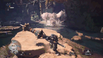

《怪物猎人：世界》，雄火龙龙吼，素材来自油管，KCGemini，MHW Roar Dodging Compilation，侵删

雄火龙吼是MH中最标准的龙吼动作，最符合通常的动画设计理念，也是最容易躲的龙吼。雄火龙吼的动作可读性极强，简要分析其特点，可以发现：

准备帧数有56/30，将近2秒，给玩家足够的时间准备动作的剪影有非常明显的变化，头颈，翅膀的挤压和舒张，重心的起伏都极为明显全身拥有一致的动势，头颈，翅膀在同一时间挤压到最小，也同时在发出吼声的瞬间舒张到最大，因此全身所有部位的运动都可以作为玩家躲避龙吼的视觉参照。特征帧的位置友好，从挤压到最小到舒张到最大的帧数是6/30，当玩家以察觉到动势就躲，可以很舒服

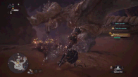

《怪物猎人：世界》，角龙吼

我想大家一般觉得角龙吼没有雄火龙吼好躲，我们也可以从动作可读性的角度分析一下原因：

准备帧数有58/30，差不多也是2秒，跟雄火龙一样动作剪影有较为明显的变化，运动主要集中在头颈部，比雄火龙幅度小吼也只有头颈有大幅度的动作，身体其他部位并没有同步的挤压与舒张的动势，无法提供躲避的视觉参照特征帧模糊，头颈在近似收缩到最小的位置停留约12/30帧，使得挤压到舒张的动势变化难以判断

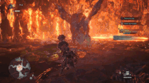

《怪物猎人：世界》，炎王龙吼

比角龙更难躲的龙吼是炎王龙，看一下炎王龙为什么不易读：

准备帧数有27/30，相比前面几乎砍了一半动作剪影比角龙的变化大，集中在躯干和翅膀，不在头部直觉上发出吼声的头部没有挤压与舒张的动势，随随便便就吼出来了，躯干与翅膀的运动节律与吼声完全错开，起到了一定的视觉干扰的作用特征帧极度模糊，难以找到特征帧作为提示闪避操作的视觉参照

**围绕读的设计**

读作为一种玩法广泛存在于格斗游戏中，而PVE游戏中也未尝不可以有关于读的设计，以上MHW即是一个例子。相比于高反应频率的游戏，低反应频率的游戏拥有更丰富的空间去探索关于读的玩法。

前面说，魂系列一开始暴露出了全部的深度，而后仅靠外部设计提升难度，这个说法是少有偏颇的。作为一款“奖励细心观察的玩家”的游戏，魂3和血源对于动作可读性做了很多针对性的设计，一般强力的敌人都会有多个招式，出手帧数快慢不等，要求玩家仔细观察掌握敌人的行动。例如：

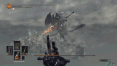

《黑暗之魂3》无名的拖延攻击，素材来自油管，RabbitRetrospectGames，Dark Souls3 All Boss Fights，侵删

怪物身上常见的拖延攻击（Delay Attack），在挤压到最小时拖延一段时间，通过模糊出手的动势以降低可读性。魂系列PVP中有一个术语叫Panic Roll（瞎几把滚？），即挨打了就立即翻滚，希望脱离危险。而上图中Boss拖延了11/30帧的长距离刺击就是针对这种玩家行为的设计，可以刚好错过玩家的翻滚无敌帧，还能打到翻滚时40%的额外伤害。

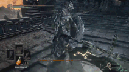

《黑暗之魂3》猎龙铠甲的假动作，素材来源同上

假动作的性质比拖延攻击更恶劣，先以一个假动势骗出闪避，再追加攻击。图中的玩家虽然并没有骗到，但是还是被这个有点无赖的攻击距离压制了。同样的设计也见多种Stance类的武器战技。

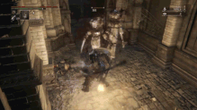

《血源诅咒：老猎人》中的小怪连击，素材来自FightingCowboy，Bloodborne: The Old Hunters Walkthrough - Part 5，侵删

血源DLC将对Panic Roll的针对设计更提升了一个层次，要求玩家在一个毫无征兆的连击中根据受击的节奏找机会闪开或者枪反，研究所的小怪与鲨鱼都是其中典型。这已经属于放飞自我型了，可读性极低，惩罚性极高，体验极差，删游戏了。

**4.1.3. 辅助设计**

辅助设计指的是，当原本的动画可读性不够时，为了辅助玩家理解，专门添加的额外设计，一般表现为UI特效与音效。

**a) UI特效提示**

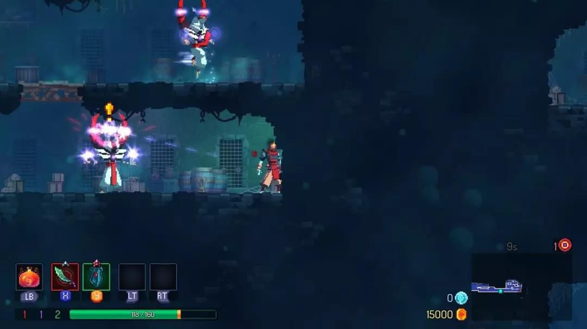

《死亡细胞》中怪物攻击前的感叹号提示

《死亡细胞》一是款鼓励玩家高速杀怪高速移动的游戏，并且游戏有相对丰富的地形穿越玩法，因此需要较大的视野，单位在画面中就显得小了。因此在怪物出手之前就会有一个黄色感叹号的UI提示。当然，对于独立游戏而言，用UI增强可读性的好处是可以降低动画的成本，许多怪物攻击动作就2帧，加个特效也像是那么回事。

其他的UI/特效提示包括战神2018的黄圈与腰上的罗盘，贝姐怪物出手前的白光，暗影魔多的招架提示和远程怪物射击提示等。一般来说，越依赖动作玩法、强调动作表现的游戏越不愿意用纯粹的UI来指示怪物的出手时机，但是特效往往是必要的。

**b) 音效提示**

例如地狱之刃中脑内声音的语音提示、贝姐中号兵远程攻击的喇叭声、Furi中的近战敌人出剑前的音效提示等，不一。

**4.2. 观赏性**

观赏性指的是游戏专门供人审美欣赏的部分。一般来说最好在满足可读性的前提下，再谈观赏性。

理论上，观赏性部分主要是动画与特效师专长的领域，可是我不会做动画也不会做特效，没有太多的发言权。不过鉴于本文的科普性质，还是尽我所能，简要提及一些设计原则与制作技巧，希望能够对大家有所帮助。

**4.2.1. 动作**

这一部分是动画师涉足的领域，轮不到游戏设计师插手，所以我还是不乱扯了。这里附一个B站搬运的有中字的链接，动画设计的12准则，12 Principles of Animation，说得肯定比我能说的好上10倍。

如果不看的话，那听我简单讲两句也好。12原则主要针对的是2D手绘动画，我根据自己理解，从中抽取一些对于3D动画，尤其是观赏性提升有帮助的部分。

a) Anticipation，预备动作，表现力量不可或缺的因素。另外，预期也极大地服务于动作可读性。

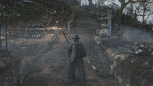

1/2速度下《血源诅咒》埋葬之刃双手形态蓄力攻击，素材来自油管，Seraphim17，Bloodborne All Weapons Showcase

市面上大量动作游戏喜欢用循环动画+逐步增强的特效来强化对力量的预期，而From家则喜欢用越来越夸张的姿势展示蓄力的形态。通常认为From家对动作不算擅长，这里倒是稍稍走在了前列。

b) Ease In and Out，平滑处理，指的是一般的运动需要有缓进缓出，控制好动作的节奏，最主要是创造动势。

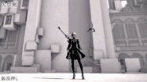

《尼尔：自动人形》的大剑轻攻击长按，素材来自油管，Ora Tashiro，【NieR-Automata】2B 全武器モーション鑑賞動画 All actions

尼尔的动作预期极短，速度极快，因此并没有夸张的力量感，但是有很长的Ease Out，动势逐步减弱以显出动静对比。当然大量运用的弧线轨迹贡献甚多，例如摆臂、转体、武器消失的特效等，给人舞蹈一般优雅的感觉。

c) Arc，弧线，对形状与轨迹的控制，丰富的曲线能够大幅提升动感，增加视觉趣味。不然为什么大家都喜欢亚尔特留斯与法兰不死队呢？

《守望先锋》小美的Highlight展示动画

除了这种运动镜头外，守望先锋还非常擅用古典迪斯尼的橡皮管动画技巧，用一些物理上不可能的形态来突出弧线，使动态更容易被人捕捉。当然，关于夸张尺度的拿捏，依然需要大量的经验支持。

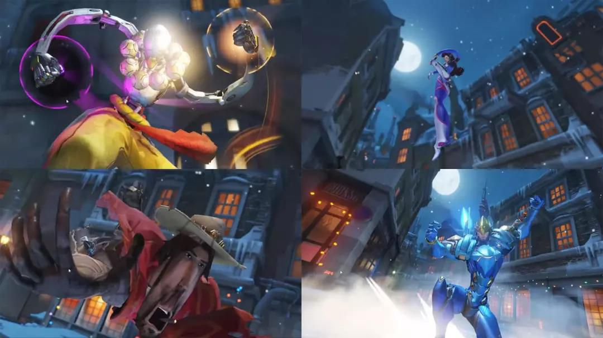

**4.2.2. 辅助演出**

**a) 时间伸缩**

时间伸缩在是影视中常用的强调动作表现的技巧。对于一般运动节奏偏快的动作游戏，可以用来强调表现一些特定的效果，并作为节奏的调剂。具体的使用方式其实可以相当灵活。比如：

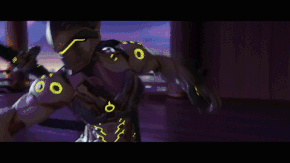

《守望先锋：双龙》

慢镜，用来放大正常速度下运动中无法被人感知的细节。上图中慢镜特写配合优雅的弧线运用，无需多言，安静感受。

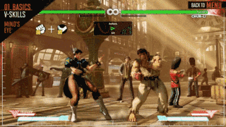

1/4速度，《街霸5》隆的心眼技能展示，冻结长达15/60帧，并且伴随微小的相机Zoom In，素材来自油管，Street Fighter，SFV - Ryu Official Character Guide

帧冻结，在命中的瞬间令游戏时间静止，用来体现运动受到滞阻，是表现打击力量感的常用手法。

基于帧冻结的思路，可以继续延展下去强调出利器与钝器的区别。钝器可以直接在命中时开启帧冻结以表现整体对整体的冲撞，而利器可以在命中之后稍迟一点点，并且控制帧冻结的强度，用快->停->慢->快的节奏来模拟从肉砍进骨头又砍过去的阻滞感，当然前提是有足够多的帧数与表现这种节奏，毕竟可读性是第一要义。不同的游戏因为同步技术或者其他玩法要求的原因，实现帧冻结的方式不尽相同，例如上图中，在角色进入冻结状态时，特效与背景依然可以正常运动。多人实时同步的游戏一般只会令攻击方陷入冻结状态，如果你没发现的话，也是得益于最小反应时间的功劳。

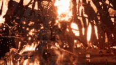

《地狱之刃》中的集中玩法，环境的时间减慢了，素材来自油管，Boss Fight Database，Hellblade Senua's Sacrifice: Surt, God of the Fire Boss Fight

时间异步，指的是玩家的时间与环境中的时间不一致。当然，这也依赖游戏中对应的机制才能够实现。上图中Boss的时间并没有明显减慢，但是特效的时间减慢效果就十分明显，多次攻击的命中特效能够叠加，提升了视觉满足感。

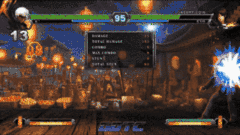

KOF XIII》中K'的必杀技，素材出自油管，Don'tDropThatCombo，K' combo tutorial

快进。时间伸缩理论上包括了加快与减慢，不过通过快速、抽帧等欺骗玩家的眼睛的做法，多数是在动画制作与动画接续规则阶段就设计好的，很少会再通过外部辅助的方式来执行。另外，抽帧的方式确实也更适合序列帧动画的2D游戏。

**b) 震屏**

震屏也是表现碰撞的力量感的常用方式。关于震屏的介绍主要参考两个视频就够了

GDC 2016 Squirrel Eiserloh - Juicing Your Cameras With MathJan Willem Nijman - The Art of Screenshake，此处附迷之声的中文搬运链接

个人以为，震屏是一个非常好从技术上理解运动感觉的入口，因为能够控制相机运动的参数非常有限，控制视点运动的Pan和Dolly，控制视角运动的Pitch/Yaw/Roll，以及每一个轴上的曲线与扰动，非常方便建立运动于直观感受之间的联系。不过毕竟本文的主旨并不在于相机设计，等有时间再专门写一篇文章，总结一下自己关于相机设计的各种心得。

**c) 特写演出**

有效的特写演出都是上述的各种动画与辅助演出技巧的综合运用。如果说有值得一提的东西的话，那就是，这种复杂的空间运动中要尽可能地避免玩家操作，因为相机的运动会破坏玩家的方向感。所以很多主流游戏也很乖巧地在这些阶段加入了QTE。

不再多说，贴两张图Pass。

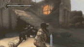

《忍者龙剑传3》的饭纲落，慢镜 + 相机运动的演出动画，如果落地震屏的话效果会更好一些

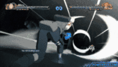

《火影忍者疾风传：究极忍者风暴4》，春野樱的必杀演出，相机运动 + 慢镜 + 震屏 + 爆炸特效

**4.2.3. 其他**

由于观赏性主要关系到视觉，所以还有很多关于特效、UI、表情演技等等，这些都是大可以单独拿出来讨论的东西，不过我能涵盖的内容实在有限，就不展开来说了。如果以后有机会，我也会试着写一篇文章，整理一下自己研究的关于UI跳数字的做法。

**4.2.4. 观赏性与可读性的平衡**

游戏中偶尔会出现观赏性与可读性不可兼得的情况。我个人的倾向是可读性永远大于观赏性，毕竟游戏是给玩家玩的。当然也不是绝对的，牺牲一部分可读性来换取观赏性问题不大，毕竟读是一个玩家可以通过练习掌握的技能。这里简要列举一些，因为强调观赏性而破坏了可读性的例子。

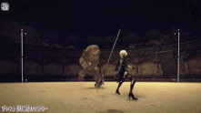

尼尔的长枪回避攻击，好看是很好看的，只是闪避的时候我人哪去了？

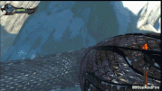

《战神：升天》，素材来自油管，MKIceAndFire，God Of War Ascension - Walkthrough Part 3

战神此处明显过于强调宏大的场面，一条大蛇盘山而上是很壮观，可是如果不看到右边的连击数在涨，光看画面几乎无法感觉到有战斗在发生。

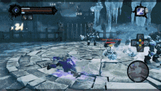

《暗黑血统2》中怪物的漂移攻击，素材来自油管，TurboButtons，The Conflicted Combat of Darksiders 2

暗黑血统2这个可以说是纯粹的反面教材了。怪物的攻击的准备动作中完全看不出来这个动作会有的位移。

**小结**

对于动作设计来说，视觉趣味是一个非常扎实的落脚点。游戏设计的方方面面多数取决于核心体验、市场考量等，但是好看的动作多由直观经验所保证，是所有人都能明确地感知到的。不过还是尽可能优先满足动画可读性的基本要求，不要为了看起来好看而让玩起来艰难。

**4.3. 直观与训练**

前面提到，直观的经验是一种自然而然形成的东西，但是从根本上说，直观依然是训练的结果。一些原本需要通过思辨来处理的内容，经过模式化的处理、加工与强化之后，人可以不用再每一次都重复思考的过程，从而更快速地得出结果，最后形成了不假思索的直观感觉。对于一个10个月的儿童，当年把一个球从他面前拿走时，他会觉得球消失了，而对于一个20岁的成年人，硬币消失的魔术都未必骗得了他。物体不会凭空消失，是人的物理经验形成的直观认识。

我这里有一个关于训练的活生生的例子。我们组里有一名程序员，从来不玩动作游戏，自认老年选手，只是不幸陪我做了一年多的动作游戏的相机、操控、弹道之类的东西。前一阵子，他心血来潮打起《黑魂3》，古达和冰狗都是初见就过了。听起来是不是很励志？

当然，这个例子也有反面的应用。比如，由于我工作以来参与的游戏全都失败了，所以我没有关于做完一款游戏的直观经验。虽然很多问题都是可以通过推演大致解决的，但是缺少直观经验，依然令人有理由怀疑我处理问题的效率。所以，凭借失败的的经验就很难找到工作。

另外一个悲伤的事实是，能够处理复杂的信息，很多时候并不意味着人变得更聪明了。直观是依赖特定的思维模式形成的，因此多数时候，拥有直观，只是人们将自己的思维训练得更善于解决特定的问题。国际象棋棋手能够记忆复杂的棋谱，并不意味着他就拥有高超的记忆术，只是他将自己训练得更擅于记忆棋谱。

不过，我们对人的成就的评价，终究也是从解决问题的方面看的，毕竟独立于一切之外的聪明是一个玄学的概念。现代人终究要在各种复杂的信息中生活，越能够有效地处理特定的复杂的问题，便有越高的成就——为此，一个优秀的棋手不会因为自己不是优秀的程序员而失色。另一个好消息是，有许多的问题最终是相通的，许多复杂的系统会共享相似的子系统，或是呈现出相似的特性。因此，善于解决一些问题能够有效地帮助地解决另一些问题。如果说从事游戏开发这些时间， 学到了什么重要的事情，大概就是不畏惧复杂的心态。能够解决曾经无法解决的问题，也是游戏，尤其是强调训练的动作游戏，带给我们的成就与喜悦所在。

**再来看看难度曲线**

整理一下，我们得到：

深度是处理复杂信息的速度直观是通过思维模式跳过了处理步骤而直接得到答案，事实上更快地处理了信息直观可以训练

因此，训练可以帮助玩家探索游戏的深度。

即便不经过特别的训练，人的大脑也是一个极强的直觉加工机器，或者说偷懒的机器。它从来不打算做到最好，只会做到足够好，如果细致地分辨不能产生有意义的结果，那么就止于粗略地认知，因此没有显著差别的东西都会被认为是一样的而批量处理掉——比如200个橘子里的第75个与第76个，比如1077年的1月27日与1月28日，比如尼尔中的小型剑轻攻击7连击。

这里说产生有意义的结果，依赖的是离散的认知模式，即人能够认知到的显著的不同。如果知道1077年的1月27日是神圣罗马帝国国王亨利四世被教皇格利高里七世拒之门外祈求宽恕的第三天，而1月28日可怜的国王终于得到了教皇的接见，人便可以有意义地区分这两天。如果要区分1077年1月27日的下午4点和下午5点，那便需要更加丰富的信息作为标尺。对于动作游戏设计，如果不能有意义地区分每一个动作，创造一些这个动作可以但是那个动作不行的情况，那么最终将很快被人的直观所抹平——没有什么区别嘛，所以一顿乱按就好。技表虽然增加了内容，带来了些许深度，但是由于玩家并没有建立区分这些内容的标尺，便很快地被人的直观抹去了。

因此（其实前面也提到过了），对于游戏深度的设计，尤其主打PVE内容的，关于深度 / 难度的定义其实并不是静态的。渐进结构本身就依赖一个时间的维度，这样我们就有了深度 / 难度曲线，并将我们引回了大家都熟悉的心流曲线设计。这方面的讨论已经很丰富了，我就不多说了。这里只是针对直观再简要扯两句。

由于直观是依赖于思维模式的，因此直观是有可能失效的，当新出现的问题超出了原本的思维模式的有效范围之后，直观很可能无法得到正确的答案。就好比前面猎龙铠甲的假动作，便是在挑战玩家对于人的架势与运动的直观，这一直观往往是在游戏之外形成的。想要在复杂的游戏中做得真正出色，就需要更加丰富的训练。深度非常大的游戏，例如竞技类的Moba、FPS和RTS经常会有战队教练的角色，经常会去整理对手的风格。这里说的风格，其实也是一套基于思维模式形成的应对技巧。

另外，挑战玩家的直观可以造成一种意外感，优秀的例子如Stanley Parable。当然，这种颠覆性的做法常常会面临一些风险，控制不当便会由惊喜变成不适，尤其是对于动作游戏来说，颠覆玩家通过训练换来的直观难免会显得不太公平。

**后记**

很多地方还没说到位，该总结的地方没总结，但是没有力气再写了，就先发出来，以后有机会慢慢补上。

撰文过程中无意读到一位老师对于结构胜于旨趣的学术写作规范的批判，深以为然，于是本文就跟着越写越零散，渐渐到了无可挽回的地步。所以参考资料什么的也还是不列了，毕竟只是个人积累，也不必这么煞有介事。

关于我参与开发的游戏，这里有个链接（[https://www.taptap.com/app/145105](https://www.taptap.com/app/145105)），不过预约什么的可以不必了，因为已经被公司叫停了。

用理性来拆解审美体验，难免会有一种隔的感觉。希望等到再经历多些训练，到看山还是山的时候，会有不一样的风景。
